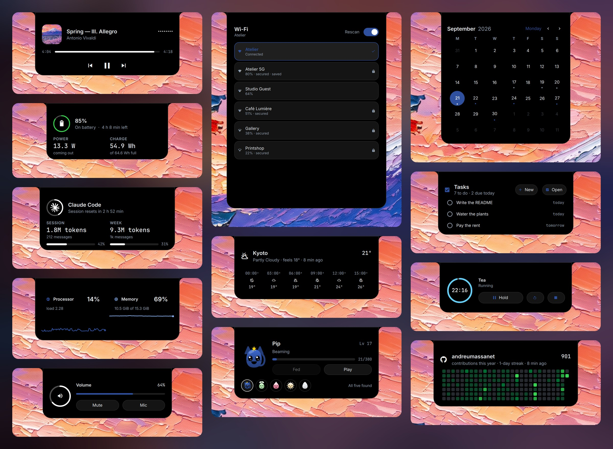
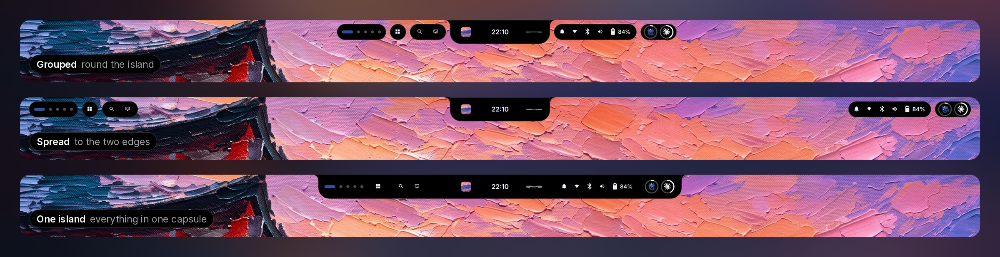

<p align="center">
  
</p>

<p align="center">
  <b>A Hyprland shell whose colours come from a painting.</b><br>
  One black island that changes shape, a desk of widgets under the windows,<br>
  and every program around it repainted by whatever wallpaper is up.
</p>

<p align="center">
  <a href="https://github.com/andreumassanet/impasto/actions/workflows/check.yml"></a>
  
  
  
  <a href="LICENSE"></a>
</p>

<p align="center">
  <a href="https://trendshift.io/repositories/233611"></a>
  <a href="https://trendshift.io/repositories/233611"></a>
</p>

<p align="center">
  <a href="https://andreumassanet.github.io/impasto-docs/"><b>Documentation</b></a> ·
  <a href="#the-island">The island</a> ·
  <a href="#the-bar">The bar</a> ·
  <a href="#the-desktop">The desktop</a> ·
  <a href="#liquid-glass">Liquid glass</a> ·
  <a href="#installation">Installation</a> ·
  <a href="#keys">Keys</a>
</p>

<p align="center">
  
</p>

The name is the technique the wallpapers are painted in: paint laid on thick
enough to keep the mark of the brush. It is a shell first and a dotfiles
repository second — `home/.config/quickshell` is most of the code, and the rest
of `home/` is the desk around it: the terminal, the prompt, two editors, two
file managers, a browser, a chat client, the login screen. **Change the
wallpaper and all of it follows.**

## The island

<p align="center">
  
</p>

**The island is one object that changes shape.** A black capsule in the middle
of the bar rests on the time and turns into everything else: the glance under
the pointer, the control centre, the launcher, the overview, a notification, a
game — each the size of what is in it, with no title and no close button. What
is running sits either side of the time — a countdown, the track, or whatever
is using the microphone, the camera or the screen — and every module on the bar
opens into the island rather than into a popup of its own. A notification
arrives there with its buttons, and stays in the control centre's list.

<p align="center">
  
</p>

## The bar

<p align="center">
  
</p>

**Four styles, one layout.** Pieces are dragged out of a catalogue onto a
picture of the bar, then drawn grouped round the island, spread to the edges,
all inside one capsule, or on a bezel across the top edge that the island
drops out of. The screen's corners can be rounded to match. A module tells you something and opens its detail; a
button opens something — any panel the control centre does, the capture
surface, or Settings. Each shows its symbol or its ring, with its figure
always, never or under the pointer — two settings for the whole bar, and any
piece can have a look of its own. The sides sit in capsules or straight on the
wallpaper, the workspace strip is dots, bars, rings or numbers written out, and
a tray holds the icons applications put there.

**On more than one screen, every screen gets the whole bar**, and the island is
live on the one you are typing on. Each screen keeps widgets and notes of its
own and the dock is on all of them, a workspace number brings that workspace to
the screen you are on, and the brightness keys dim that screen — an external
monitor over DDC/CI.

## The desktop

<p align="center">
  
</p>

**The palette comes out of the painting.** Pick a wallpaper and its colours
reach everything at once: the island and the widgets, the terminal, neovim,
VSCodium, the GTK and Qt windows, Nautilus down to its folders, Vesktop, Zen
and Spotify. Thirty-three paintings come with it, and a video can be the wallpaper
too.

**Any module can live on the wallpaper**, on a grid, in four shapes, drawn in
one of three themes: *Modern*, *Analogue* or *Sticker*. Right-click the
wallpaper to arrange it.

## Liquid glass

<p align="center">
  
</p>

**Every layer picks its material**: the island and the bar, the dock, the
widgets and the terminal, each classic, glass or liquid. The windows can bend
the painting at their edges too.

## Everything else, in the island

<p align="center">
  
</p>

**Every tool is a panel of the island**, not a window: notes, tasks, eleven
games, screen time, virtual machines, the servers you have running, your
packages and effects for the webcam in any call. A pet lives on the bar, and
<kbd>SUPER</kbd> <kbd>H</kbd> lists the key for each.

## Lock and login

<p align="center">
  
</p>

**The lock shows what is playing**: the cover blurred behind it and the
lyrics in time. **With an infrared camera it opens for your face.** The login
screen and the boot splash are the same design, before there is a session.

## Installation

Arch Linux and Hyprland 0.56 or newer, from a terminal or a console:

```bash
git clone https://github.com/andreumassanet/impasto.git ~/impasto
cd ~/impasto
./setup install
```

It installs what is missing, copies `home/` and `system/` into place, and sets
up the login screen, the plugins and the programs around the shell. Run
`./setup` alone to pick from a menu instead.

<details>
<summary><b>Flags</b></summary>
<br>

| Flag | |
|---|---|
| `--skip-packages` | install nothing; copy and build only |
| `--skip-system` | leave `/` alone — no login screen, no printing, and no password for it |
| `--skip-plugins` | no shake to find, no glass |
| `--skip-extras` | leave Nautilus, VSCodium, Vesktop, Spotify, GTK, face unlock, the camera and the boot splash alone |
| `--shell-only` | only the shell and Hyprland: `~/.config/quickshell`, `~/.config/hypr` (never its `custom/` folder), the shell's data, the wallpapers and the `impasto` command. The packages are the full list, and `--skip-packages` installs none. No `/`, no plugins, no extras, no other program's config, and the palette is written to none of the other programs until you choose some in Settings › Appearance. Remembered, so `update` and `sync` keep to it |
| `--full` | everything again, and forget `--shell-only` |
| `--aur-helper yay\|paru` | which helper builds the AUR half — built from the AUR if you have neither |
| `--noconfirm` | take the default at every question |
| `-n`, `--dry-run` | say what would happen, and do none of it |

</details>

```bash
./setup update       # git pull, then install again — the same flags
./setup uninstall    # remove what it installed, and put back what it moved aside
./setup help         # every verb and flag
```

Nothing is linked: `setup` copies, keeps a backup of anything in the way, and
never overwrites a file you edited.

<details>
<summary><b>Your own Hyprland changes</b></summary>
<br>

A file in `~/.config/hypr/custom/` named like a module in
`~/.config/hypr/modules/` is loaded right after it, so it can change what the
module set, and `setup update` never touches it. A file that is not there is
skipped.

```lua
-- ~/.config/hypr/custom/keybinds.lua
hl.bind("SUPER + D", hl.dsp.exec_cmd("drawio"), { description = "App: draw.io" })
```

The modules are `monitors`, `autostart`, `env`, `look`, `animations`,
`input`, `keybinds` and `windowrules`. To change an existing key, use
Settings → Keys instead.

</details>

<details>
<summary><b>Components</b></summary>
<br>

| | | |
|---|---|---|
| 🪟 | Compositor | [Hyprland](https://hypr.land) |
| 🖱️ | Shake to find | [hypr-dynamic-cursors](https://github.com/VirtCode/hypr-dynamic-cursors) |
| 🫧 | Glass on the windows | [hyprglass](https://github.com/hyprnux/hyprglass) |
| 🐚 | Desktop shell | [Quickshell](https://quickshell.org) |
| 🖼️ | Wallpaper daemon | [awww](https://github.com/LGFae/swww) |
| 🖥️ | Terminal | [kitty](https://sw.kovidgoyal.net/kitty/) |
| ⌨️ | Interactive shell | [zsh](https://www.zsh.org) · [oh-my-zsh](https://ohmyz.sh) |
| ❯ | Prompt | [starship](https://starship.rs) |
| 🎨 | Greeting | [fastfetch](https://github.com/fastfetch-cli/fastfetch) |
| 📊 | System monitor | [btop](https://github.com/aristocratos/btop) |
| 🎵 | Audio visualiser | [cava](https://github.com/karlstav/cava) |
| 📁 | File manager | [yazi](https://yazi-rs.github.io) |
| 🗂️ | File manager in a window | [Nautilus](https://apps.gnome.org/Nautilus/) |
| ✏️ | Editor | [neovim](https://neovim.io) |
| 📝 | Editor in a window | [VSCodium](https://vscodium.com) |
| 🖼️ | Image viewer | [imv](https://sr.ht/~exec64/imv/) |
| 🪄 | Annotator | [satty](https://github.com/gabm/Satty) |
| 💬 | Chat | [Vesktop](https://github.com/Vencord/Vesktop) |
| 🎧 | Player | [Spotify](https://www.spotify.com) · [spicetify](https://spicetify.app) |
| 🌐 | Browser | [Zen](https://zen-browser.app) |
| 🔆 | Monitor brightness | [ddcutil](https://www.ddcutil.com) |
| 🖨️ | Printing | [CUPS](https://openprinting.github.io/cups/) · [Avahi](https://avahi.org) |
| 🔑 | Login screen | [SDDM](https://github.com/sddm/sddm) |
| 🎨 | Boot splash | [Plymouth](https://gitlab.freedesktop.org/plymouth/plymouth) |
| 👤 | Face unlock | [howdy-next](https://codeberg.org/nathawat/howdy-next) |
| 📷 | Camera effects | [MediaPipe](https://ai.google.dev/edge/mediapipe) · [v4l2loopback](https://github.com/umlaeute/v4l2loopback) |

</details>

## Keys

Every key belongs to a profile: Settings → Keys changes any of them, the
compositor's included, and switching profile switches them all. A few worth
knowing first:

- <kbd>SUPER</kbd> <kbd>Return</kbd> a terminal, <kbd>SUPER</kbd> <kbd>Space</kbd>
  the launcher, <kbd>SUPER</kbd> <kbd>Q</kbd> closes the window
- <kbd>SUPER</kbd> <kbd>1</kbd>…<kbd>0</kbd> a workspace, on the screen you are
  on, <kbd>SUPER</kbd> <kbd>TAB</kbd> all of them at once
- <kbd>SUPER</kbd> <kbd>ALT</kbd> <kbd>←</kbd> <kbd>→</kbd> the other screen,
  adding <kbd>SHIFT</kbd> takes the workspace with you
- <kbd>SUPER</kbd> <kbd>X</kbd> the session menu, <kbd>SUPER</kbd> <kbd>L</kbd>
  locks
- <kbd>SUPER</kbd> <kbd>H</kbd> every other key, on the island

## Credits

These are worth your time whether or not you use this repository. No code was
copied from any of them; what carried over from the shells are ideas — one file
per island state, one transient signal for every ephemeral event, and input
debounced to one frame.

- [saneAspect](https://www.youtube.com/@saneAspect) — the Hyprland setups on
  YouTube that started all this
- [Tide-island](https://github.com/enhaoswen/Tide-island) — the closest thing to
  a complete dynamic island for Hyprland
- [ChillPill-Shell](https://github.com/LUCKYS1NGHH/ChillPill-Shell) — a dynamic
  pill bar built to stay light without a dedicated GPU
- [k4](https://github.com/k4ditano/k4) — a dynamic island bar with a documented
  plugin API
- [diegoMalagrida/dotfiles](https://github.com/diegoMalagrida/dotfiles) — an
  Arch Linux desk ready to install on a fresh system

Built on [Quickshell](https://quickshell.org) and [Hyprland](https://hypr.land).
The pointer is [Bibata](https://github.com/ful1e5/Bibata_Cursor), repainted;
the folders are [Papirus](https://github.com/PapirusDevelopmentTeam/papirus-icon-theme),
re-pointed; the type is [Inter](https://rsms.me/inter/) and
[JetBrains Mono](https://www.jetbrains.com/lp/mono/). Six of the nine palettes
are other people's work, carried as they are:
[Catppuccin](https://catppuccin.com) Mocha and Latte,
[Tokyo Night](https://github.com/folke/tokyonight.nvim),
[Gruvbox](https://github.com/morhetz/gruvbox), [Nord](https://www.nordtheme.com)
and [Rosé Pine](https://rosepinetheme.com).

## Star history

<a href="https://star-history.com/#andreumassanet/impasto&Date">
  <picture>
    <source media="(prefers-color-scheme: dark)" srcset="https://api.star-history.com/svg?repos=andreumassanet/impasto&type=Date&theme=dark">
    
  </picture>
</a>

## License

Copyright © 2026 Andreu Massanet — released under the [GNU GPL-3.0](LICENSE).

You may use, study, change and share any of it. If you build on it and pass the
result on, it stays under the GPL and its source stays available. Keep the
header at the top of each file, which carries this repository's address, and a
line of credit back here is the kind thing to do.
